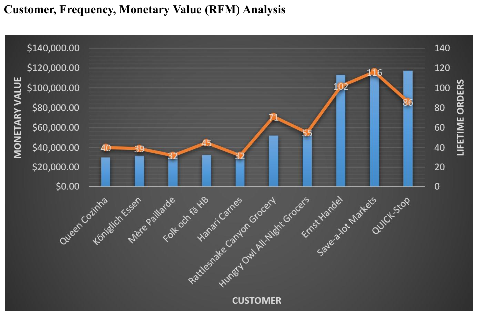
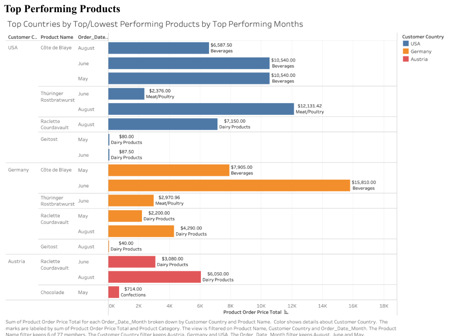
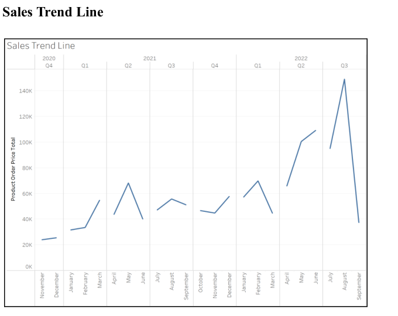

# Northwind Traders — Global Sales & Customer Analysis

**Business Intelligence · Tableau · Customer Segmentation · Sales Trends · Business Recommendations**

A team-based business analytics project completed for **CIS 235 at Arizona State University (Spring 2024)**. As a member of a six-person team, I contributed to a final analysis and proposed request for proposal (RFP) concerning a fictional global trading company. The report examines sales performance across countries, product categories, customers, and time periods.

> **Portfolio format:** The original Tableau workbooks, spreadsheet source, and any project code are no longer available. This repository preserves a **redacted copy of the original team report**, with three charts excerpted from that report. It does **not** claim that underlying code or dashboards were recreated.

## [View the full 10-page project report](report/northwind_sales_analysis_public.pdf)

## Project overview

The team used transaction summaries and visual analytics to understand:

- Geographic differences in revenue and product/category performance.
- Customer value, order frequency, recency, and customers potentially at risk of churn.
- High- and low-performing product categories and seasonal sales patterns.
- Business data gaps and information required for better supply-chain decisions.

## Highlights from the team report

| Area | Finding reported by the team |
|---|---|
| Revenue concentration | The ten highest-value customers represented **46% of total monetary value**. |
| Customer retention | RFM analysis identified **five customers** with no orders for over six months as at risk of churn. |
| Sales geography | The **United States, Germany, and Austria** were the highest-revenue countries in the report. |
| Seasonal performance | **August, May, and June** were the strongest months by the report's comparison with average monthly revenue. |
| Product categories | **Beverages, dairy products, and confections** were leading categories. |

These are historical descriptive findings from the team's dataset and analysis; they are not causal claims or forecasts, and do not describe the current retail market.

## Selected visuals (from the original report)

**Customer RFM and revenue concentration (report page 4)**



**Product performance by country and month (report page 2)**



**Monthly sales trends (report page 6)**



## Recommendations and project deliverable

The report concludes with business recommendations and an **RFP proposal** for further data collection on product costs, supplier pricing, shipping, and procurement. The RFP describes **proposed future work**; it does not establish that the team carried out vendor negotiations, implemented operational changes, or achieved cost savings.

## Files

```text
northwind-sales-customer-analysis/
├── README.md
├── report/
│   └── northwind_sales_analysis_public.pdf
├── assets/
│   ├── customer_rfm_analysis.png
│   ├── product_performance.png
│   └── sales_trends.png
└── PROJECT_NOTES.md
```

## Scope and attribution

- **Academic group project:** Original analysis, charts, report, and RFP were collaborative work by **Team 3A (six students)**. I was a team member; this repository does not assign every finding or visualization to me individually.
- **Preserved sources:** The complete report (10 pages), except for student contact details and class links, and cropped chart excerpts.
- **Not preserved:** Source spreadsheet, Tableau `.twb`/`.twbx` workbooks, scripts, and original working files. The figures are images embedded in the submitted report, not interactive dashboards.
- **Portfolio privacy:** This public copy removes the class roster/contact table and a team member's personal contact details. The original group submission is not included here.
- **Data provenance:** The report references a Northwind Traders global sales dataset with transactions through September 2022. Its original data file and redistribution rights have not been verified; no dataset is redistributed here.

The README is new portfolio documentation; it was not part of the original class submission.
